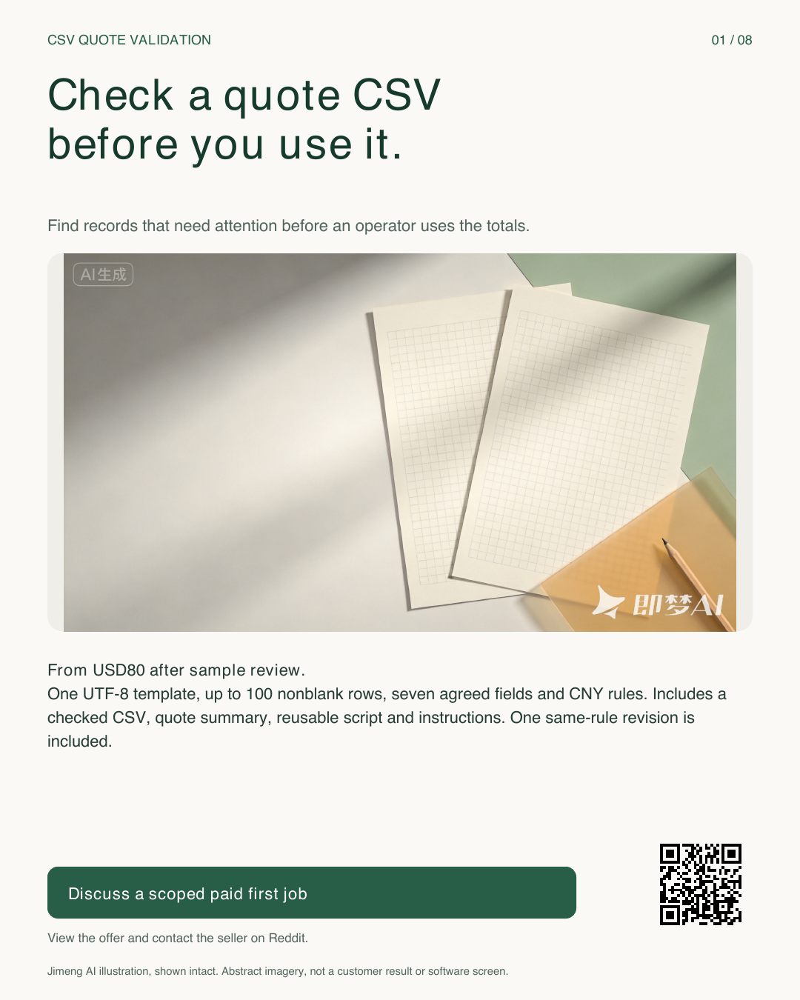
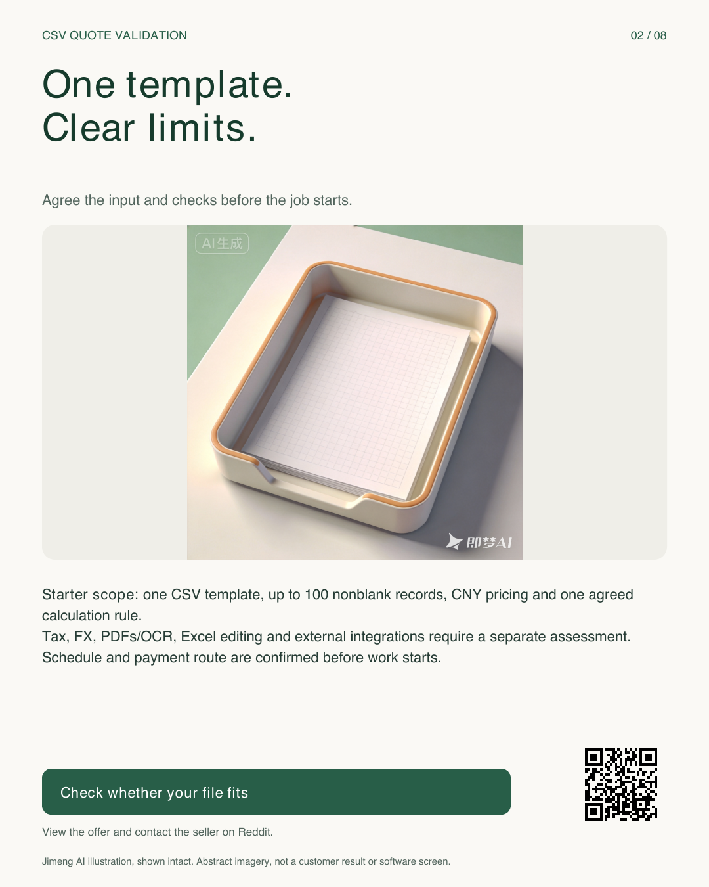
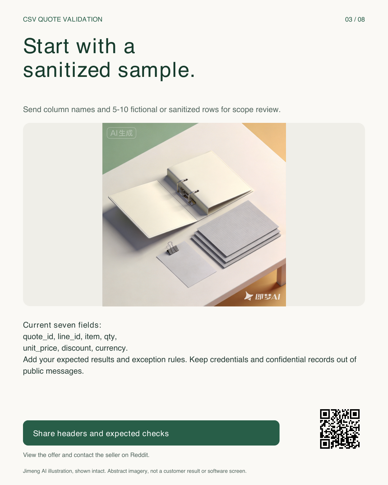
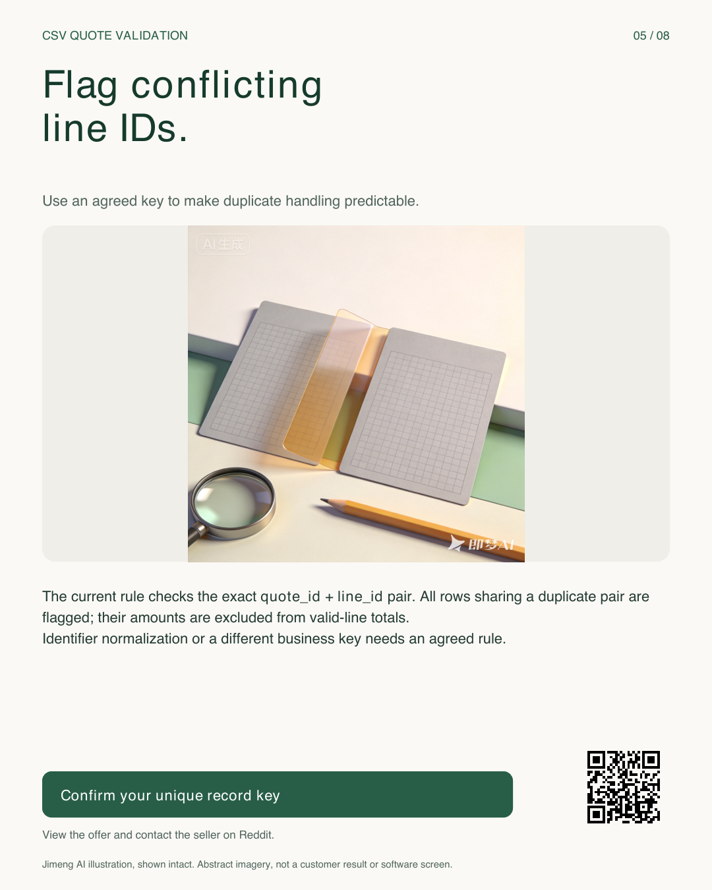
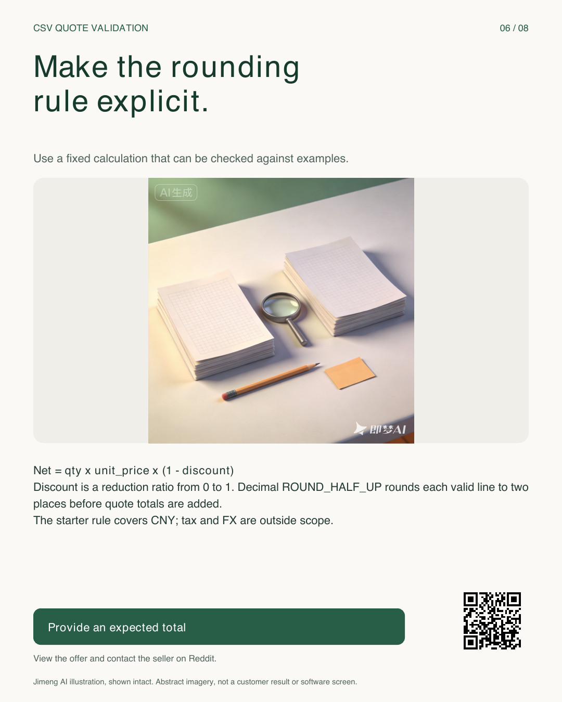
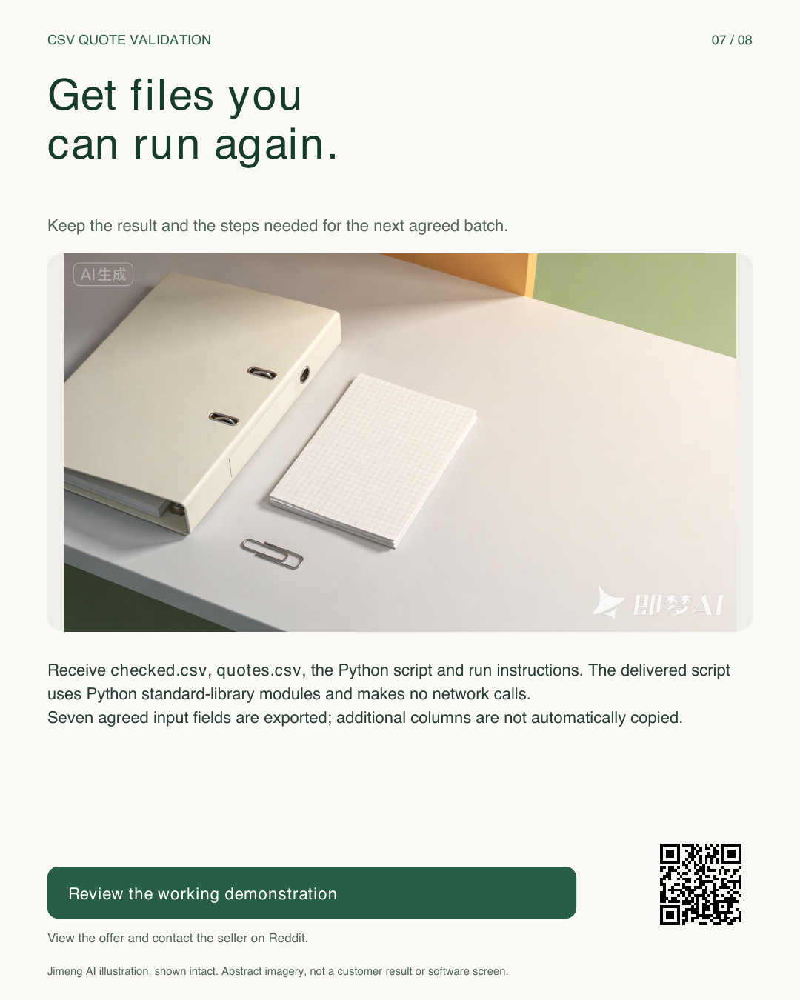
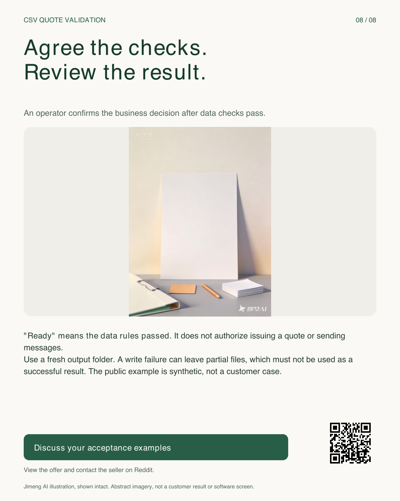

# CSV quote validation service

[Discuss a scoped paid first job on Reddit](https://www.reddit.com/r/PythonJobs/comments/1xrw3eo/forhire_fullremote_python_csv_quote_validation/) · [Inspect the working synthetic demonstration](https://gist.github.com/Tiancheng-Xu/b06921b6a135692b9fd408ac10398a4d)

From **USD80 after sample review**: one UTF-8 CSV template, up to **100 nonblank rows**, seven agreed fields and CNY pricing rules. Includes checked.csv, quotes.csv, a reusable Python script, instructions and one same-rule revision. Timing and payment route are agreed before work starts.

The current fields are quote_id, line_id, item, qty, unit_price, discount and currency. Tax, foreign-exchange conversion, PDFs/OCR, Excel editing and external integrations need a separate assessment. Ready means data rules passed; a human still makes the business decision.

## Eight-page visual guide

Select a card to read it at full size. Every illustration is AI-generated in Jimeng and shown intact with its visible platform marks. These are abstract images, not customer results or software screenshots. Service text and numbers were typeset locally; the original background files were not regenerated.

| 01 01-service | 02 02-scope |
|---|---|
|  |  |

| 03 03-input | 04 04-missing |
|---|---|
|  |  |

| 05 05-duplicates | 06 06-amounts |
|---|---|
|  |  |

| 07 07-delivery | 08 08-review |
|---|---|
|  |  |

## Before a quote

Send column names, 5-10 fictional or sanitized rows, the checks you expect, your budget and target date through the existing Reddit service contact. Keep credentials and confidential records out of public comments. Rules and acceptance examples are agreed before work starts.

The demonstration is self-initiated and synthetic, not a paid client case. The delivered Python script runs locally with standard-library modules. Input files stay unchanged; extra columns are not automatically copied to generated outputs. Write failures can leave partial outputs, which must not be used as successful results.

[Image provenance and hashes](provenance.json)
